# QUORIX — Database Architecture & Relational Schema Design

This specification defines the normalized PostgreSQL 16 schema, data types, indexes, foreign key constraints, and relational mappings for QUORIX.

---

## 1. Entity-Relationship Diagram (ERD)

```mermaid
erDiagram
    users ||--o| profiles : "has one"
    users ||--o{ user_sessions : "maintains"
    users ||--o{ email_verification_tokens : "receives"
    users ||--o{ password_reset_tokens : "requests"
    users ||--o| notification_preferences : "configures"
    users ||--o{ articles : "authors"
    users ||--o{ comments : "writes"
    users ||--o{ likes : "gives"
    users ||--o{ bookmarks : "saves"
    users ||--o{ follows : "follows/followed_by"
    users ||--o{ publication_members : "belongs to"
    users ||--o{ admin_audit_logs : "performs action"
    users ||--o{ reports : "submits"

    categories ||--o{ articles : "categorizes"
    publications ||--o{ articles : "publishes"
    publications ||--o{ publication_members : "has members"
    publications ||--o| custom_domains : "future-ready"

    articles ||--o{ article_versions : "revisions"
    articles ||--o{ article_tags : "tagged with"
    tags ||--o{ article_tags : "tags article"
    articles ||--o{ comments : "receives"
    articles ||--o{ likes : "receives"
    articles ||--o{ bookmarks : "saved in"
    articles ||--o{ article_views : "accumulates"
    articles ||--o{ daily_analytics : "aggregated in"

    comments ||--o{ comments : "parent/replies"
    comments ||--o{ reports : "reported in"
    articles ||--o{ reports : "reported in"

    advertisements ||--o{ ad_placements : "displays on"
    ad_placements ||--o{ ad_impressions : "logs"
    ad_placements ||--o{ ad_clicks : "logs"

    email_outbox ||--o{ email_logs : "tracks delivery"
```



---

## 2. Table Specifications by Domain

### 2.1 Identity, Authentication & User Management

#### `users`
Core account table for authentication and global authorization.
```sql
CREATE TYPE user_role AS ENUM ('user', 'author', 'moderator', 'admin', 'super_admin');
CREATE TYPE user_status AS ENUM ('pending_verification', 'active', 'suspended', 'deactivated');

CREATE TABLE users (
    id UUID PRIMARY KEY DEFAULT gen_random_uuid(),
    email VARCHAR(255) NOT NULL UNIQUE,
    password_hash VARCHAR(255) NOT NULL,
    role user_role NOT NULL DEFAULT 'user',
    status user_status NOT NULL DEFAULT 'pending_verification',
    email_verified_at TIMESTAMPTZ,
    last_login_at TIMESTAMPTZ,
    created_at TIMESTAMPTZ NOT NULL DEFAULT NOW(),
    updated_at TIMESTAMPTZ NOT NULL DEFAULT NOW(),
    deleted_at TIMESTAMPTZ
);
CREATE INDEX idx_users_email ON users(email);
CREATE INDEX idx_users_role ON users(role);
CREATE INDEX idx_users_status ON users(status);
```

#### `profiles`
Public developer profile details.
```sql
CREATE TABLE profiles (
    user_id UUID PRIMARY KEY REFERENCES users(id) ON DELETE CASCADE,
    username VARCHAR(50) NOT NULL UNIQUE,
    display_name VARCHAR(100) NOT NULL,
    headline VARCHAR(160),
    bio TEXT,
    avatar_url TEXT,
    github_url VARCHAR(255),
    twitter_url VARCHAR(255),
    linkedin_url VARCHAR(255),
    website_url VARCHAR(255),
    location VARCHAR(100),
    article_count INT NOT NULL DEFAULT 0,
    follower_count INT NOT NULL DEFAULT 0,
    following_count INT NOT NULL DEFAULT 0,
    created_at TIMESTAMPTZ NOT NULL DEFAULT NOW(),
    updated_at TIMESTAMPTZ NOT NULL DEFAULT NOW()
);
CREATE UNIQUE INDEX idx_profiles_username_lower ON profiles(LOWER(username));
```

#### `user_sessions`
Active refresh token sessions with rotation and revocation support.
```sql
CREATE TABLE user_sessions (
    id UUID PRIMARY KEY DEFAULT gen_random_uuid(),
    user_id UUID NOT NULL REFERENCES users(id) ON DELETE CASCADE,
    refresh_token_hash VARCHAR(64) NOT NULL UNIQUE, -- SHA-256 hash of token
    user_agent TEXT,
    ip_address INET,
    expires_at TIMESTAMPTZ NOT NULL,
    is_revoked BOOLEAN NOT NULL DEFAULT FALSE,
    created_at TIMESTAMPTZ NOT NULL DEFAULT NOW(),
    updated_at TIMESTAMPTZ NOT NULL DEFAULT NOW()
);
CREATE INDEX idx_user_sessions_user_id ON user_sessions(user_id);
CREATE INDEX idx_user_sessions_token_hash ON user_sessions(refresh_token_hash);
CREATE INDEX idx_user_sessions_expires_at ON user_sessions(expires_at) WHERE is_revoked = FALSE;
```

#### `email_verification_tokens` & `password_reset_tokens`
Single-use expiring verification and security tokens.
```sql
CREATE TABLE email_verification_tokens (
    id UUID PRIMARY KEY DEFAULT gen_random_uuid(),
    user_id UUID NOT NULL REFERENCES users(id) ON DELETE CASCADE,
    token_hash VARCHAR(64) NOT NULL UNIQUE,
    expires_at TIMESTAMPTZ NOT NULL,
    used_at TIMESTAMPTZ,
    created_at TIMESTAMPTZ NOT NULL DEFAULT NOW()
);
CREATE INDEX idx_evt_token_hash ON email_verification_tokens(token_hash);

CREATE TABLE password_reset_tokens (
    id UUID PRIMARY KEY DEFAULT gen_random_uuid(),
    user_id UUID NOT NULL REFERENCES users(id) ON DELETE CASCADE,
    token_hash VARCHAR(64) NOT NULL UNIQUE,
    expires_at TIMESTAMPTZ NOT NULL,
    used_at TIMESTAMPTZ,
    created_at TIMESTAMPTZ NOT NULL DEFAULT NOW()
);
CREATE INDEX idx_prt_token_hash ON password_reset_tokens(token_hash);
```

#### `notification_preferences`
User preferences for transactional and engagement notifications.
```sql
CREATE TABLE notification_preferences (
    user_id UUID PRIMARY KEY REFERENCES users(id) ON DELETE CASCADE,
    email_new_comment BOOLEAN NOT NULL DEFAULT TRUE,
    email_new_reply BOOLEAN NOT NULL DEFAULT TRUE,
    email_new_follower BOOLEAN NOT NULL DEFAULT TRUE,
    email_article_published BOOLEAN NOT NULL DEFAULT TRUE,
    email_digest BOOLEAN NOT NULL DEFAULT FALSE,
    updated_at TIMESTAMPTZ NOT NULL DEFAULT NOW()
);
```

---

### 2.2 Content, Articles & Taxonomies

#### `categories` & `tags`
Curated hierarchy and community technical tags.
```sql
CREATE TABLE categories (
    id UUID PRIMARY KEY DEFAULT gen_random_uuid(),
    name VARCHAR(100) NOT NULL UNIQUE,
    slug VARCHAR(100) NOT NULL UNIQUE,
    description TEXT,
    icon_name VARCHAR(50),
    sort_order INT NOT NULL DEFAULT 0,
    created_at TIMESTAMPTZ NOT NULL DEFAULT NOW()
);

CREATE TABLE tags (
    id UUID PRIMARY KEY DEFAULT gen_random_uuid(),
    name VARCHAR(50) NOT NULL UNIQUE,
    slug VARCHAR(50) NOT NULL UNIQUE,
    description TEXT,
    usage_count INT NOT NULL DEFAULT 0,
    created_at TIMESTAMPTZ NOT NULL DEFAULT NOW()
);
CREATE INDEX idx_tags_slug ON tags(slug);
CREATE INDEX idx_tags_usage_count ON tags(usage_count DESC);
```

#### `publications` & `publication_members`
Multi-author team publishing entities.
```sql
CREATE TYPE publication_role AS ENUM ('owner', 'editor', 'writer');

CREATE TABLE publications (
    id UUID PRIMARY KEY DEFAULT gen_random_uuid(),
    name VARCHAR(100) NOT NULL,
    slug VARCHAR(100) NOT NULL UNIQUE,
    description TEXT,
    logo_url TEXT,
    banner_url TEXT,
    created_by UUID NOT NULL REFERENCES users(id) ON DELETE RESTRICT,
    created_at TIMESTAMPTZ NOT NULL DEFAULT NOW(),
    updated_at TIMESTAMPTZ NOT NULL DEFAULT NOW()
);

CREATE TABLE publication_members (
    publication_id UUID NOT NULL REFERENCES publications(id) ON DELETE CASCADE,
    user_id UUID NOT NULL REFERENCES users(id) ON DELETE CASCADE,
    role publication_role NOT NULL DEFAULT 'writer',
    joined_at TIMESTAMPTZ NOT NULL DEFAULT NOW(),
    PRIMARY KEY (publication_id, user_id)
);

-- Future-ready custom domains schema (strictly non-MVP, defined for structural compliance)
CREATE TABLE custom_domains (
    id UUID PRIMARY KEY DEFAULT gen_random_uuid(),
    publication_id UUID NOT NULL UNIQUE REFERENCES publications(id) ON DELETE CASCADE,
    domain VARCHAR(255) NOT NULL UNIQUE,
    is_verified BOOLEAN NOT NULL DEFAULT FALSE,
    verification_token VARCHAR(255),
    created_at TIMESTAMPTZ NOT NULL DEFAULT NOW(),
    updated_at TIMESTAMPTZ NOT NULL DEFAULT NOW()
);
```

#### `articles`
Main technical article repository with PostgreSQL Full-Text Search.
```sql
CREATE TYPE article_status AS ENUM ('draft', 'published', 'archived', 'unlisted');

CREATE TABLE articles (
    id UUID PRIMARY KEY DEFAULT gen_random_uuid(),
    author_id UUID NOT NULL REFERENCES users(id) ON DELETE RESTRICT,
    publication_id UUID REFERENCES publications(id) ON DELETE SET NULL,
    category_id UUID REFERENCES categories(id) ON DELETE SET NULL,
    title VARCHAR(255) NOT NULL,
    slug VARCHAR(255) NOT NULL UNIQUE,
    subtitle VARCHAR(350),
    content TEXT NOT NULL,               -- Full raw Markdown
    content_html TEXT NOT NULL,          -- Sanitized rendered HTML for fast RSC delivery
    cover_image_url TEXT,
    canonical_url TEXT,
    status article_status NOT NULL DEFAULT 'draft',
    reading_time_minutes INT NOT NULL DEFAULT 1,
    views_count INT NOT NULL DEFAULT 0,
    likes_count INT NOT NULL DEFAULT 0,
    bookmarks_count INT NOT NULL DEFAULT 0,
    comments_count INT NOT NULL DEFAULT 0,
    featured BOOLEAN NOT NULL DEFAULT FALSE,
    search_vector TSVECTOR,             -- Auto-generated tsvector for FTS
    published_at TIMESTAMPTZ,
    created_at TIMESTAMPTZ NOT NULL DEFAULT NOW(),
    updated_at TIMESTAMPTZ NOT NULL DEFAULT NOW(),
    deleted_at TIMESTAMPTZ
);

-- Full text search trigger & GIN index
CREATE INDEX idx_articles_search ON articles USING GIN(search_vector);
CREATE INDEX idx_articles_status_published ON articles(status, published_at DESC) WHERE status = 'published' AND deleted_at IS NULL;
CREATE INDEX idx_articles_author_id ON articles(author_id);
CREATE INDEX idx_articles_category_id ON articles(category_id);
CREATE INDEX idx_articles_featured ON articles(featured) WHERE featured = TRUE;

-- Article tag association
CREATE TABLE article_tags (
    article_id UUID NOT NULL REFERENCES articles(id) ON DELETE CASCADE,
    tag_id UUID NOT NULL REFERENCES tags(id) ON DELETE RESTRICT,
    PRIMARY KEY (article_id, tag_id)
);
CREATE INDEX idx_article_tags_tag_id ON article_tags(tag_id);

-- Revision history
CREATE TABLE article_versions (
    id UUID PRIMARY KEY DEFAULT gen_random_uuid(),
    article_id UUID NOT NULL REFERENCES articles(id) ON DELETE CASCADE,
    version_number INT NOT NULL,
    title VARCHAR(255) NOT NULL,
    content TEXT NOT NULL,
    created_by UUID NOT NULL REFERENCES users(id) ON DELETE RESTRICT,
    created_at TIMESTAMPTZ NOT NULL DEFAULT NOW(),
    UNIQUE (article_id, version_number)
);
```

---

### 2.3 Social Engagement & Community

#### `comments`
Hierarchical, threaded comments for technical discussion.
```sql
CREATE TABLE comments (
    id UUID PRIMARY KEY DEFAULT gen_random_uuid(),
    article_id UUID NOT NULL REFERENCES articles(id) ON DELETE CASCADE,
    author_id UUID NOT NULL REFERENCES users(id) ON DELETE CASCADE,
    parent_id UUID REFERENCES comments(id) ON DELETE CASCADE,
    content TEXT NOT NULL,
    is_edited BOOLEAN NOT NULL DEFAULT FALSE,
    is_deleted BOOLEAN NOT NULL DEFAULT FALSE,
    created_at TIMESTAMPTZ NOT NULL DEFAULT NOW(),
    updated_at TIMESTAMPTZ NOT NULL DEFAULT NOW()
);
CREATE INDEX idx_comments_article_id ON comments(article_id, created_at ASC);
CREATE INDEX idx_comments_parent_id ON comments(parent_id);
```

#### `likes`, `bookmarks` & `follows`
Unique user interaction state.
```sql
CREATE TABLE likes (
    user_id UUID NOT NULL REFERENCES users(id) ON DELETE CASCADE,
    article_id UUID NOT NULL REFERENCES articles(id) ON DELETE CASCADE,
    created_at TIMESTAMPTZ NOT NULL DEFAULT NOW(),
    PRIMARY KEY (user_id, article_id)
);
CREATE INDEX idx_likes_article ON likes(article_id);

CREATE TABLE bookmarks (
    user_id UUID NOT NULL REFERENCES users(id) ON DELETE CASCADE,
    article_id UUID NOT NULL REFERENCES articles(id) ON DELETE CASCADE,
    created_at TIMESTAMPTZ NOT NULL DEFAULT NOW(),
    PRIMARY KEY (user_id, article_id)
);
CREATE INDEX idx_bookmarks_user ON bookmarks(user_id, created_at DESC);

CREATE TABLE follows (
    follower_id UUID NOT NULL REFERENCES users(id) ON DELETE CASCADE,
    following_id UUID NOT NULL REFERENCES users(id) ON DELETE CASCADE,
    created_at TIMESTAMPTZ NOT NULL DEFAULT NOW(),
    PRIMARY KEY (follower_id, following_id),
    CHECK (follower_id <> following_id)
);
CREATE INDEX idx_follows_following ON follows(following_id);
```

---

### 2.4 Analytics & Telemetry

#### `article_views` & `daily_analytics`
Privacy-preserving deduplicated view logging.
```sql
CREATE TABLE article_views (
    id BIGSERIAL PRIMARY KEY,
    article_id UUID NOT NULL REFERENCES articles(id) ON DELETE CASCADE,
    viewer_hash VARCHAR(64) NOT NULL, -- Hashed IP + UserAgent salt for deduplication
    user_id UUID REFERENCES users(id) ON DELETE SET NULL,
    viewed_at TIMESTAMPTZ NOT NULL DEFAULT NOW()
);
CREATE INDEX idx_article_views_article_time ON article_views(article_id, viewed_at);
CREATE UNIQUE INDEX idx_article_views_dedup ON article_views(article_id, viewer_hash, (viewed_at::DATE));

CREATE TABLE daily_analytics (
    id BIGSERIAL PRIMARY KEY,
    article_id UUID NOT NULL REFERENCES articles(id) ON DELETE CASCADE,
    date DATE NOT NULL,
    views_count INT NOT NULL DEFAULT 0,
    unique_visitors INT NOT NULL DEFAULT 0,
    likes_delta INT NOT NULL DEFAULT 0,
    comments_delta INT NOT NULL DEFAULT 0,
    bookmarks_delta INT NOT NULL DEFAULT 0,
    created_at TIMESTAMPTZ NOT NULL DEFAULT NOW(),
    UNIQUE (article_id, date)
);
CREATE INDEX idx_daily_analytics_date ON daily_analytics(date DESC);
```

---

### 2.5 Advertisement Engine

#### `advertisements`, `ad_placements`, `ad_impressions`, `ad_clicks`
Modular advertisement tracking without simulated or fabricated counts.
```sql
CREATE TYPE ad_placement_location AS ENUM ('homepage_feed', 'explore_feed', 'article_content', 'article_sidebar', 'footer');
CREATE TYPE ad_status AS ENUM ('active', 'paused', 'expired');

CREATE TABLE advertisements (
    id UUID PRIMARY KEY DEFAULT gen_random_uuid(),
    title VARCHAR(150) NOT NULL,
    provider VARCHAR(50) NOT NULL DEFAULT 'custom', -- 'custom', 'adsense'
    target_url TEXT NOT NULL,
    image_url TEXT,
    script_snippet TEXT,                            -- For Google AdSense script integration
    is_active BOOLEAN NOT NULL DEFAULT TRUE,
    created_at TIMESTAMPTZ NOT NULL DEFAULT NOW(),
    updated_at TIMESTAMPTZ NOT NULL DEFAULT NOW()
);

CREATE TABLE ad_placements (
    id UUID PRIMARY KEY DEFAULT gen_random_uuid(),
    advertisement_id UUID NOT NULL REFERENCES advertisements(id) ON DELETE CASCADE,
    location ad_placement_location NOT NULL,
    is_enabled BOOLEAN NOT NULL DEFAULT TRUE,
    priority INT NOT NULL DEFAULT 1,
    created_at TIMESTAMPTZ NOT NULL DEFAULT NOW()
);

CREATE TABLE ad_impressions (
    id BIGSERIAL PRIMARY KEY,
    placement_id UUID NOT NULL REFERENCES ad_placements(id) ON DELETE CASCADE,
    viewer_hash VARCHAR(64) NOT NULL,
    impressed_at TIMESTAMPTZ NOT NULL DEFAULT NOW()
);
CREATE INDEX idx_ad_impressions_placement ON ad_impressions(placement_id, impressed_at);

CREATE TABLE ad_clicks (
    id BIGSERIAL PRIMARY KEY,
    placement_id UUID NOT NULL REFERENCES ad_placements(id) ON DELETE CASCADE,
    viewer_hash VARCHAR(64) NOT NULL,
    clicked_at TIMESTAMPTZ NOT NULL DEFAULT NOW()
);
CREATE INDEX idx_ad_clicks_placement ON ad_clicks(placement_id, clicked_at);
```

---

### 2.6 Outbox, Governance & Platform Settings

#### `email_outbox` & `email_logs`
PostgreSQL Transactional Outbox.
```sql
CREATE TYPE email_status AS ENUM ('PENDING', 'PROCESSING', 'SENT', 'FAILED');

CREATE TABLE email_outbox (
    id UUID PRIMARY KEY DEFAULT gen_random_uuid(),
    recipient_email VARCHAR(255) NOT NULL,
    template_name VARCHAR(100) NOT NULL,
    subject VARCHAR(255) NOT NULL,
    payload JSONB NOT NULL,
    status email_status NOT NULL DEFAULT 'PENDING',
    retry_count INT NOT NULL DEFAULT 0,
    max_retries INT NOT NULL DEFAULT 5,
    next_retry_at TIMESTAMPTZ NOT NULL DEFAULT NOW(),
    error_message TEXT,
    ses_message_id VARCHAR(255),
    created_at TIMESTAMPTZ NOT NULL DEFAULT NOW(),
    updated_at TIMESTAMPTZ NOT NULL DEFAULT NOW()
);
CREATE INDEX idx_email_outbox_queue ON email_outbox(status, next_retry_at) WHERE status IN ('PENDING', 'PROCESSING');

CREATE TABLE email_logs (
    id UUID PRIMARY KEY DEFAULT gen_random_uuid(),
    outbox_id UUID REFERENCES email_outbox(id) ON DELETE SET NULL,
    recipient_email VARCHAR(255) NOT NULL,
    template_name VARCHAR(100) NOT NULL,
    ses_message_id VARCHAR(255),
    status email_status NOT NULL,
    error_message TEXT,
    attempted_at TIMESTAMPTZ NOT NULL DEFAULT NOW()
);
```

#### `reports`, `admin_audit_logs` & `platform_settings`
```sql
CREATE TYPE report_target_type AS ENUM ('article', 'comment', 'user');
CREATE TYPE report_status AS ENUM ('pending', 'reviewed', 'dismissed', 'action_taken');

CREATE TABLE reports (
    id UUID PRIMARY KEY DEFAULT gen_random_uuid(),
    reporter_id UUID NOT NULL REFERENCES users(id) ON DELETE CASCADE,
    target_type report_target_type NOT NULL,
    target_id UUID NOT NULL,
    reason VARCHAR(255) NOT NULL,
    details TEXT,
    status report_status NOT NULL DEFAULT 'pending',
    reviewed_by UUID REFERENCES users(id) ON DELETE SET NULL,
    reviewed_at TIMESTAMPTZ,
    created_at TIMESTAMPTZ NOT NULL DEFAULT NOW()
);
CREATE INDEX idx_reports_status ON reports(status);

CREATE TABLE admin_audit_logs (
    id UUID PRIMARY KEY DEFAULT gen_random_uuid(),
    admin_id UUID NOT NULL REFERENCES users(id) ON DELETE RESTRICT,
    action VARCHAR(100) NOT NULL,
    target_type VARCHAR(50) NOT NULL,
    target_id VARCHAR(100) NOT NULL,
    details JSONB,
    ip_address INET,
    created_at TIMESTAMPTZ NOT NULL DEFAULT NOW()
);
CREATE INDEX idx_audit_logs_admin_id ON admin_audit_logs(admin_id, created_at DESC);

CREATE TABLE platform_settings (
    key VARCHAR(100) PRIMARY KEY,
    value JSONB NOT NULL,
    description TEXT,
    updated_by UUID REFERENCES users(id) ON DELETE SET NULL,
    updated_at TIMESTAMPTZ NOT NULL DEFAULT NOW()
);
```
