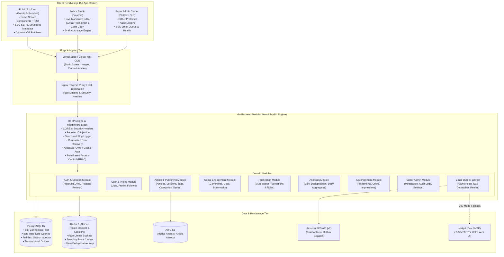
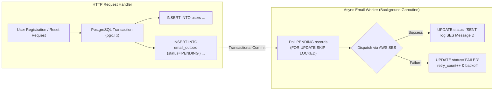
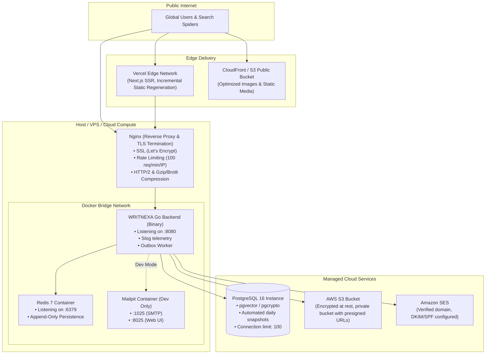

# WRITNEXA — Comprehensive System Architecture & Engineering Blueprint

This document specifies the technical architecture, directory structure, module boundaries, security protocols, and operational workflows for WRITNEXA.

---

## 1. High-Level System Architecture

WRITNEXA is architected as a **Modular Monolith**. It delivers microservice-grade domain boundaries while retaining the operational simplicity, transactional consistency, and single-binary deployment velocity of a unified Go backend and a Next.js App Router frontend.



---

## 2. Frontend Architecture (Next.js App Router)

The frontend leverages Next.js 15+ App Router, maximizing performance through Server Components (RSC) for public content while isolating interactive client state in dedicated leaves.

### 2.1 Route Organization & Route Groups

```
frontend/src/app/
├── (public)/                      # Public Explorer Route Group (Clean URLs, SSR, SEO)
│   ├── page.tsx                   # Homepage (Featured, Trending, Recent feeds)
│   ├── article/[slug]/            # Full article reader (RSC, zero-client-JS reading)
│   ├── author/[username]/         # Public author profile & articles
│   ├── tag/[slug]/                # Tag feed
│   ├── category/[slug]/           # Category feed
│   ├── search/                    # Full-text search with instant filters
│   └── publication/[slug]/        # Public publication profile
├── (author)/                      # Author Studio Route Group (Auth Required)
│   └── studio/
│       ├── layout.tsx             # Studio navigation, draft indicator, profile summary
│       ├── page.tsx               # Author dashboard (Recent drafts, view counts, quick actions)
│       ├── articles/              # Article manager (Published, Drafts, Scheduled, Archived)
│       ├── editor/
│       │   ├── page.tsx           # New article editor
│       │   └── [id]/page.tsx      # Edit existing article / draft
│       ├── series/                # Manage article series
│       └── analytics/             # In-depth reader stats & engagement charts
├── (admin)/                       # Super Admin Center Route Group (RBAC Protected)
│   └── admin/
│       ├── layout.tsx             # Admin sidebar, role guard, system alert bar
│       ├── page.tsx               # Admin overview & system metrics
│       ├── users/                 # User & author role management, suspensions
│       ├── articles/              # Moderation, flagged posts, unpublish actions
│       ├── publications/          # Publication reviews & management
│       ├── ads/                   # Ad placements, CTR, impressions, toggle switches
│       ├── emails/                # Outbox queue inspection, SES delivery logs
│       ├── audit-logs/            # Immutable administrative audit logs
│       └── settings/              # Platform configurations & runtime toggles
├── (auth)/                        # Authentication Flow (Centered Minimalist Layout)
│   ├── login/page.tsx             # Sign in with email/password + redirect back
│   ├── register/page.tsx          # Account registration
│   ├── verify-email/page.tsx      # Email verification token handler
│   ├── forgot-password/page.tsx   # Password reset request
│   └── reset-password/page.tsx    # Password reset submission
├── api/                           # Next.js Route Handlers (Edge proxies / webhooks if needed)
├── layout.tsx                     # Global Root Layout (Fonts, Theme Provider, Toast Provider)
└── not-found.tsx                  # Custom 404
```

### 2.2 Server vs. Client Component Strategy

- **React Server Components (Default)**:
  - Article Reader (`/article/[slug]`): Renders complete HTML, markdown content, metadata, and initial comments on the server. Delivers near-instant First Contentful Paint (FCP) and optimal SEO indexing.
  - Public Feeds & Author Profiles: Server-fetched queries directly targeting backend REST endpoints.
- **Client Components (`'use client'`)**:
  - Markdown Editor: Multi-pane editor with live rendering, code block line highlighting, word/reading-time counters, auto-save timers.
  - Interactive Action Buttons: Like, Bookmark, Follow, and Comment submitters with optimistic UI updates and guest auth redirection triggers.
  - Studio and Admin Dashboards: Filterable data tables, charts, dropdowns, and modal dialogs.

### 2.3 Markdown Authoring & Code Rendering Pipeline

1. **Editor**: Monospace-focused, distraction-free textarea with live cursor synchronization and local storage crash-resilience.
2. **Parser**: Unified/Remark/Rehype pipeline with:
   - `rehype-pretty-code` or `shiki` for server/client tokenized syntax highlighting across 50+ programming languages.
   - Line numbers, line highlighting (`{3-5}`), and file title tabs (`title="main.go"`).
   - One-click copy-to-clipboard button with visual checkmark feedback.
   - Sanitized HTML output via `rehype-sanitize` to eliminate XSS vectors from author-submitted markup.
3. **Image Handling**: Drag-and-drop or clipboard paste triggers an immediate upload request to the backend S3 presigned URL endpoint, inserting `` markdown into the editor upon completion.

---

## 3. Go Backend Modular Architecture

The backend is built in Go 1.26 using Gin, strictly adhering to clean modular monolith boundaries. Each domain module encapsulates its own routing, handler, service logic, and database access.

### 3.1 Directory Structure

```
backend/
├── cmd/
│   ├── api/
│   │   └── main.go                # Application bootstrap, DI wireup, graceful shutdown
│   └── migrate/
│       └── main.go                # Goose database migration CLI
├── internal/
│   ├── config/                    # Strongly typed config via viper / env
│   │   └── config.go
│   ├── database/                  # pgxpool lifecycle, migrations & sqlc integration
│   │   ├── postgres.go            # pgx connection pool initialization & health
│   │   └── goose.go               # Programmatic Goose migration runner
│   ├── redis/                     # Redis client setup & connection verification
│   │   └── redis.go
│   ├── logger/                    # Structured logging using standard library log/slog
│   │   └── logger.go
│   ├── middleware/                # Global and route-level middlewares
│   │   ├── cors.go                # Strict CORS policies
│   │   ├── recovery.go            # Panic recovery with structured stack traces
│   │   ├── request_id.go          # X-Request-ID propagation
│   │   ├── logger.go              # Request/response slog telemetry
│   │   ├── auth.go                # JWT extraction, cookie verification, user injection
│   │   ├── rbac.go                # Role checking (user, author, moderator, admin, super_admin)
│   │   └── rate_limit.go          # Token bucket / sliding window rate limiter via Redis
│   ├── response/                  # Standardized JSON response envelope
│   │   └── response.go
│   ├── email/                     # Transactional email outbox & SES dispatcher
│   │   ├── outbox.go              # Outbox writer (transactional)
│   │   ├── worker.go              # Async background poller with backoff & retry
│   │   ├── ses_client.go          # AWS SDK v2 SES client implementation
│   │   └── dev_client.go          # Local logger / Mailpit SMTP implementation
│   ├── storage/                   # Media & file storage abstraction
│   │   ├── storage.go             # Storage interface (PresignPut, Delete, GetURL)
│   │   ├── s3.go                  # AWS SDK v2 S3 implementation
│   │   └── local.go               # Local disk implementation for development
│   └── modules/                   # Independent Domain Modules
│       ├── auth/                  # Registration, Login, JWT, Refresh Tokens, Password Reset
│       │   ├── handler.go
│       │   ├── service.go
│       │   ├── repository.go
│       │   └── routes.go
│       ├── user/                  # User Profiles, Following, Settings
│       ├── article/               # Articles, Drafts, Revisions, Series, Tags, Categories
│       ├── social/                # Comments, Likes, Bookmarks
│       ├── publication/           # Multi-author Publications & Membership
│       ├── analytics/             # Privacy-respecting view tracker & stats aggregator
│       ├── advertisement/         # Ad placements, impression tracking, click counting
│       └── admin/                 # Audit logs, user administration, platform controls
├── migrations/                    # Sequential Goose SQL migrations
│   ├── 00001_init.sql
│   ├── 00002_create_users_and_profiles.sql
│   ├── ...
├── sqlc/                          # sqlc configuration and query definitions
│   ├── sqlc.yaml
│   └── queries/
├── go.mod
└── go.sum
```

### 3.2 Dependency Flow & Inversion

1. Modules **never** invoke another module's internal database queries directly.
2. Cross-module communication occurs via explicit Service interfaces or domain events.
3. Every database interaction operates through database transactions when mutating multiple entities.
4. Database connection pool (`pgxpool.Pool`) is passed to repositories, allowing atomic transactional execution via `pgx.Tx`.

---

## 4. Authentication, Session & Authorization Strategy

### 4.1 Cryptographic Standards

- **Password Hashing**: **Argon2id** (memory: 64 MB, iterations: 3, parallelism: 4, salt: 16 bytes, key length: 32 bytes).
- **Access Tokens**: Short-lived JWT (HMAC-SHA256, 15-minute lifespan). Payload includes `sub` (UserID), `role`, `email`, `exp`, `iat`.
- **Refresh Tokens**: Cryptographically secure 256-bit random entropy (base64url).
  - Token is stored **only as a SHA-256 hash** in `user_sessions`.
  - Sent to the client strictly inside an **HTTP-only, Secure, SameSite=Strict** cookie (`__Host-quorix-rt`).
  - Refresh token rotation: Every refresh request invalidates the used token and issues a new rotating token. If a revoked token is replayed, the entire session family is revoked immediately (theft detection).

### 4.2 Role-Based Access Control (RBAC) Matrix

Hierarchical roles are enforced at the backend middleware layer:

```
super_admin > admin > moderator > author > user
```

| Action                            | Guest | User | Author | Moderator | Admin | Super Admin |
| --------------------------------- | :---: | :--: | :----: | :-------: | :---: | :---------: |
| Read public articles & search     |  Yes  | Yes |  Yes  |    Yes    |  Yes  |     Yes     |
| View author profiles              |  Yes  | Yes |  Yes  |    Yes    |  Yes  |     Yes     |
| Like, Bookmark, Follow            |  No  | Yes |  Yes  |    Yes    |  Yes  |     Yes     |
| Post Comments / Replies           |  No  | Yes |  Yes  |    Yes    |  Yes  |     Yes     |
| Create & Save Drafts              |  No  | Yes* |  Yes  |    Yes    |  Yes  |     Yes     |
| Publish Articles                  |  No  | Yes* |  Yes  |    Yes    |  Yes  |     Yes     |
| Edit / Delete Own Articles        |  No  | Yes |  Yes  |    Yes    |  Yes  |     Yes     |
| Edit Any Article / Unpublish      |  No  |  No  |   No   |    Yes    |  Yes  |     Yes     |
| Manage User Bans / Reports        |  No  |  No  |   No   |    Yes    |  Yes  |     Yes     |
| Manage Advertisements             |  No  |  No  |   No   |    No    |  Yes  |     Yes     |
| View System Health & Email Ops    |  No  |  No  |   No   |    No    |  Yes  |     Yes     |
| Promote Users to Admin / Settings |  No  |  No  |   No   |    No    |  No  |     Yes     |

*\*Any authenticated user can publish; publishing automatically elevates/activates author profile capabilities.*

### 4.3 Guest Interaction & Redirect-Back Workflow

```mermaid
sequenceDiagram
    autonumber
    actor Guest as Guest Reader
    participant Browser as Next.js Client
    participant Backend as Go Backend
  
    Guest->>Browser: Reads article /article/go-concurrency
    Guest->>Browser: Clicks "Like" or "Bookmark"
    Browser->>Browser: Detects unauthenticated session
    Browser->>Browser: Opens Auth Modal or navigates to /login?return_to=/article/go-concurrency#like
    Guest->>Browser: Submits Login credentials
    Browser->>Backend: POST /api/v1/auth/login {email, password}
    Backend->>Backend: Verifies Argon2id & creates session
    Backend-->>Browser: 200 OK (Set-Cookie: rt; AccessToken in response)
    Browser->>Browser: Stores AccessToken in memory/state
    Browser->>Browser: Redirects to return_to (/article/go-concurrency#like)
    Browser->>Backend: POST /api/v1/articles/:id/like (Bearer AccessToken)
    Backend-->>Browser: 201 Created (Liked)
    Browser->>Guest: Displays filled Like button & updated count
```

---

## 5. Transactional Email Outbox & SES Delivery Architecture

Direct synchronous email sending in HTTP request handlers is strictly forbidden as it introduces latency spikes, timeout failures, and data inconsistency.

WRITNEXA uses the **Transactional Outbox Pattern**:



### 5.1 Outbox Reliability Guarantees

1. **Atomic Enqueue**: The email record is written within the exact same database transaction as the business event. If the database rolls back, no email is sent.
2. **`FOR UPDATE SKIP LOCKED`**: Concurrency-safe batch processing across multiple backend instances without duplicate sends.
3. **Exponential Backoff**: Failed dispatches retry up to 5 times ($2^n \times 30\text{s}$) with jitter.
4. **Audit Trail**: Every attempt records timestamp, SES `MessageId`, error text, and recipient address in `email_logs`.
5. **Development Isolation**: In `APP_ENV=development`, the worker outputs formatted emails to the local console or forwards to Mailpit (`localhost:1025`), preventing accidental customer emails.

---

## 6. Infrastructure, Storage & Deployment Architecture



### 6.1 Multi-Stage Go Dockerfile Pattern

- Stage 1: `golang:1.26-alpine` compiles statically linked binary (`CGO_ENABLED=0 GOOS=linux`).
- Stage 2: `scratch` or `alpine:3.20` contains only the static binary, CA certificates, and timezone data (~25 MB total image size).

---

## 7. Architectural Decisions & Risk Management

### Decision 1: Modular Monolith vs. Microservices

- **Decision**: Build as a modular monolith inside a single repository.
- **Rationale**: WRITNEXA requires strict transactional consistency between articles, tags, authors, and email outbox. Microservices would introduce distributed transaction overhead, network latency, and operational complexity with no initial scaling benefit.
- **Risk Mitigation**: Strict module package boundaries in Go prevent cyclic dependencies. Any module can be split into a standalone service in the future if required.

### Decision 2: PostgreSQL Full-Text Search vs. External Search Engine

- **Decision**: Use PostgreSQL native `tsvector` and `tsquery` with GIN indexing for search.
- **Rationale**: Avoids maintaining and synchronizing an external Elasticsearch/Opensearch cluster. PostgreSQL handles hundreds of thousands of articles with sub-10ms search queries using English stemming and ranking (`ts_rank`).
- **Risk Mitigation**: The search interface in the article repository abstracts the search query. If search demands exceed PostgreSQL limits, an external engine can be plugged behind the exact same interface.

### Decision 3: sqlc + pgx vs. Heavy ORM (GORM)

- **Decision**: Use `sqlc` to generate type-safe Go code from pure SQL queries, coupled with `pgxpool`.
- **Rationale**: ORMs obscure generated SQL, perform suboptimal joins, and introduce reflection overhead. `sqlc` guarantees compile-time query verification, zero reflection, and raw SQL performance.
- **Risk Mitigation**: Developers write standard SQL queries with full access to PostgreSQL-specific functions (e.g. `to_tsvector`, `json_agg`).

### Decision 4: Presigned S3 Uploads vs. Backend File Streaming

- **Decision**: Author Studio client uploads images directly to AWS S3 via backend-generated presigned PUT URLs.
- **Rationale**: Streaming large image payloads through the Go backend consumes memory and saturates backend network bandwidth. Presigned URLs allow direct client-to-S3 transfers with strict file size and MIME type restrictions.
- **Risk Mitigation**: Presigned URLs expire in 5 minutes; backend validates user identity and enforces quotas before issuing upload URLs.

---

## 8. Deployment & Ingress Specifications

For detailed architectural specifications regarding containerization, multi-stage builds, reverse proxy routing, Let's Encrypt automated SSL termination, and dual-zone DDoS mitigation, refer to:
- [Docker & NGINX Architecture Guide](file:///docs/deployment/docker_and_nginx_guide.md)
- [Production Deployment Guide](file:///docs/deployment/production_deployment_guide.md)
- [Environment Variable Reference](file:///docs/deployment/environment_variable_reference.md)

