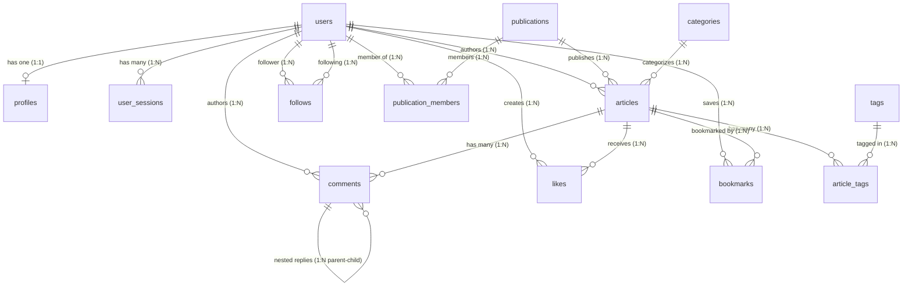

# QUORIX — Core Database Relationships & Migration Guide

This document records the Phase 2 relational schema, constraints, indexing strategies, and Goose migration workflows.

---

## 1. Relational Schema Architecture

All entities use **UUIDv4** primary keys (`gen_random_uuid()`) for decentralized identification and resistance to enumeration attacks.



---

## 2. Table Specifications & Foreign Key Rules

| Table | Primary Key | Foreign Keys & Actions | Unique Constraints | Key Indexes |
|---|---|---|---|---|
| `users` | `id` (UUID) | None | `email` | `idx_users_email`, `idx_users_role`, `idx_users_status` |
| `profiles` | `user_id` (UUID) | `user_id` -> `users(id)` **ON DELETE CASCADE** | `username` | `idx_profiles_username_lower` (`LOWER(username)`) |
| `user_sessions` | `id` (UUID) | `user_id` -> `users(id)` **ON DELETE CASCADE** | `refresh_token_hash` | `idx_user_sessions_user_id`, `idx_user_sessions_expires_at` (partial: `is_revoked = FALSE`) |
| `categories` | `id` (UUID) | None | `name`, `slug` | `idx_categories_slug` |
| `tags` | `id` (UUID) | None | `name`, `slug` | `idx_tags_slug`, `idx_tags_usage` (`usage_count DESC`) |
| `publications` | `id` (UUID) | `created_by` -> `users(id)` **ON DELETE RESTRICT** | `slug` | `idx_publications_slug` |
| `publication_members` | Composite `(publication_id, user_id)` | `publication_id` -> `publications(id)` **ON DELETE CASCADE**<br>`user_id` -> `users(id)` **ON DELETE CASCADE** | Composite PK | `idx_publication_members_user` |
| `articles` | `id` (UUID) | `author_id` -> `users(id)` **ON DELETE RESTRICT**<br>`publication_id` -> `publications(id)` **ON DELETE SET NULL**<br>`category_id` -> `categories(id)` **ON DELETE SET NULL** | `slug` | `idx_articles_status_published`, `idx_articles_author`, `idx_articles_publication`, `idx_articles_category`, `idx_articles_slug`, `idx_articles_featured`, `idx_articles_search` (GIN `search_vector`) |
| `article_tags` | Composite `(article_id, tag_id)` | `article_id` -> `articles(id)` **ON DELETE CASCADE**<br>`tag_id` -> `tags(id)` **ON DELETE RESTRICT** | Composite PK | `idx_article_tags_tag` |
| `comments` | `id` (UUID) | `article_id` -> `articles(id)` **ON DELETE CASCADE**<br>`author_id` -> `users(id)` **ON DELETE CASCADE**<br>`parent_id` -> `comments(id)` **ON DELETE CASCADE** | None | `idx_comments_article` (`article_id, created_at ASC`), `idx_comments_parent` |
| `likes` | Composite `(user_id, article_id)` | `user_id` -> `users(id)` **ON DELETE CASCADE**<br>`article_id` -> `articles(id)` **ON DELETE CASCADE** | Composite PK | `idx_likes_article` |
| `bookmarks` | Composite `(user_id, article_id)` | `user_id` -> `users(id)` **ON DELETE CASCADE**<br>`article_id` -> `articles(id)` **ON DELETE CASCADE** | Composite PK | `idx_bookmarks_user` (`user_id, created_at DESC`) |
| `follows` | Composite `(follower_id, following_id)` | `follower_id` -> `users(id)` **ON DELETE CASCADE**<br>`following_id` -> `users(id)` **ON DELETE CASCADE** | Composite PK, `CHECK (follower_id <> following_id)` | `idx_follows_following` |

---

## 3. Full-Text Search (FTS) Trigger

Articles automatically maintain a weighted `search_vector` (`tsvector`) via PostgreSQL trigger:
- **Weight A**: Title (`setweight(..., 'A')`)
- **Weight B**: Subtitle (`setweight(..., 'B')`)
- **Weight C**: Markdown content (`setweight(..., 'C')`)

The GIN index `idx_articles_search` powers sub-millisecond full-text searches without external dependencies.

---

## 4. Goose Migration Commands

Run migrations directly via the Go migration CLI runner in `backend/cmd/migrate`:

```bash
cd backend

# View current migration status
go run ./cmd/migrate status

# Apply all pending migrations
go run ./cmd/migrate up

# Roll back the most recent migration
go run ./cmd/migrate down

# View current schema version
go run ./cmd/migrate version

# Create a new migration file
go run ./cmd/migrate create <migration_name> sql
```

---

## 5. sqlc Code Generation

SQL queries in `backend/sqlc/queries/` are compiled to type-safe Go code in `backend/internal/database/sqlc/`:

```bash
cd backend/sqlc
sqlc generate
```
