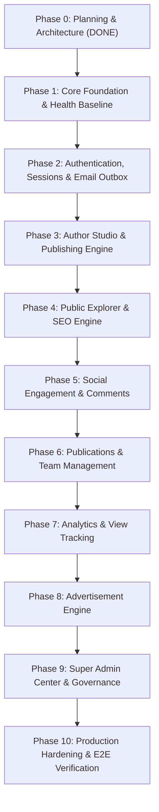

# WRITNEXA — Phased Development Roadmap & Execution Strategy

To uphold the core development rule—**build phase by phase, never generate the entire application at once, verify each phase with automated and manual tests, and obtain user approval before starting the next phase**—this roadmap outlines the complete project lifecycle.

---

## 1. Development Phases & Milestone Breakdown

---

### Phase 0: Project Planning and Architecture (Current Phase)
- **Status**: Completed (Pending Approval).
- **Deliverables**:
  - `PROJECT.md`: Product vision, target personas, core pillars, technology stack, non-negotiables.
  - `ARCHITECTURE.md`: High-level system architecture, Next.js frontend structure, Go backend modular architecture, security protocols, email outbox pattern, infrastructure diagrams.
  - `DATABASE_DESIGN.md`: Normalized PostgreSQL 16 schema, data types, indexes, foreign keys, and ERD.
  - `API_DESIGN.md`: Standardized JSON envelopes, HTTP status codes, RESTful endpoint catalog.
  - `DEVELOPMENT_ROADMAP.md`: Phased milestones, dependency graph, risk register, approval gates.

---

### Phase 1: Project Foundation, Tooling, Docker Baseline & Health Check
- **Prerequisites**: Phase 0 Approval.
- **Scope**:
  - Git repository initialization and baseline structure.
  - `docker-compose.yml` for PostgreSQL 16, Redis 7, and Mailpit.
  - Go 1.26 backend bootstrap (`backend/go.mod`, Gin web engine, structured logging with `log/slog`, CORS, Recovery, Request ID middleware).
  - Strongly typed configuration loader via environment variables (`internal/config`).
  - Database connection pool using `pgxpool` with health checks.
  - Goose migration engine runner setup and initial baseline migration (`00001_init.sql`).
  - System health check endpoints: `GET /api/v1/health` and `GET /api/v1/health/ready`.
  - Next.js 15+ App Router baseline (`frontend/`) with TypeScript, Tailwind CSS, shadcn/ui foundation, and responsive root layout.
  - API client utility with health status indicator.
  - Go backend tests for configuration and health endpoints; frontend smoke test.

---

### Phase 2: Authentication, Session Management, Security & Email Outbox
- **Prerequisites**: Phase 1 Complete.
- **Scope**:
  - PostgreSQL migrations: `users`, `profiles`, `user_sessions`, `email_verification_tokens`, `password_reset_tokens`, `email_outbox`, `email_logs`.
  - Argon2id password hashing implementation with secure parameter tuning.
  - JWT Access Token generation & verification; rotating Refresh Tokens stored as SHA-256 hashes in PostgreSQL; HTTP-only SameSite cookies.
  - Email Outbox background worker goroutine with transactional outbox pattern and SES v2 / Mailpit fallback.
  - Endpoints: Register, Login, Refresh, Logout, Verify Email, Resend Verification, Forgot Password, Reset Password, Get Current User (`/api/v1/auth/me`).
  - Frontend Auth Pages: Clean developer-themed Login, Register, Verify Email, and Password Reset screens with return-to-URL redirect behavior.
  - Automated tests for password hashing, token rotation, and outbox worker.

---

### Phase 3: Author Studio & Publishing Engine
- **Prerequisites**: Phase 2 Complete.
- **Scope**:
  - PostgreSQL migrations: `categories`, `tags`, `articles`, `article_tags`, `article_versions`.
  - AWS S3 presigned PUT URL generation endpoint for secure client-direct image uploads (with local disk dev fallback).
  - Backend article management: draft creation, autosave updates, slug generation with collision handling, markdown rendering with syntax sanitization, reading time estimation, article revision history.
  - Author Studio frontend (`/studio`):
    - Real-time Markdown editor with split-pane live preview.
    - Code syntax highlighting across languages with line numbers and copy-to-clipboard button.
    - Tag autocomplete and category dropdown.
    - Draft manager with status indicators (draft, published, archived).
    - Publishing confirmation checklist.
  - Automated tests for article publishing and versioning.

---

### Phase 4: Public Explorer, Search Engine & SEO Integration
- **Prerequisites**: Phase 3 Complete.
- **Scope**:
  - Public article listing endpoints with filters (`category`, `tag`, `sort=recent|trending`), cursor/page pagination.
  - PostgreSQL Full-Text Search using `search_vector` (`tsvector`) with GIN indexing and ranking.
  - Public Article Reader (`/article/[slug]`):
    - React Server Component rendering complete sanitized HTML on initial load.
    - Author byline, publication info, reading time, code copy functionality.
  - Public Author Profile (`/author/[username]`): bio, social links, published article feed.
  - SEO Engine: Server-side dynamic `generateMetadata`, Open Graph images, Twitter Cards, JSON-LD `Article` structured data, dynamic `sitemap.xml`, and `robots.txt`.

---

### Phase 5: Social Engagement, Comments & Following
- **Prerequisites**: Phase 4 Complete.
- **Scope**:
  - PostgreSQL migrations: `likes`, `bookmarks`, `comments`, `follows`, `notification_preferences`.
  - Social endpoints: Like/Unlike, Bookmark/Unbookmark, Follow/Unfollow, Threaded Comments & Replies.
  - Guest Action Gate: Interactive prompts when unauthenticated readers click Like, Bookmark, or Comment, with automatic return-to-scroll redirect upon login.
  - Email outbox integration: transactional email notifications dispatched when an author receives a new follower or comment.
  - Author Studio integration: notifications feed and follower counters.

---

### Phase 6: Publications & Team Management
- **Prerequisites**: Phase 5 Complete.
- **Scope**:
  - PostgreSQL migrations: `publications`, `publication_members`.
  - Publication management endpoints: create publication, invite members, assign roles (`owner`, `editor`, `writer`), submit article to publication, accept/reject submissions.
  - Public publication profile page (`/publication/[slug]`).
  - Author Studio publication switcher.

---

### Phase 7: Analytics, View Tracking & Metrics
- **Prerequisites**: Phase 5 Complete.
- **Scope**:
  - PostgreSQL migrations: `article_views`, `daily_analytics`.
  - Privacy-preserving view recording using salted IP + UserAgent hashing with daily deduplication.
  - Background worker to aggregate hourly/daily metrics (`views_count`, `unique_visitors`, `likes_delta`, `comments_delta`).
  - Author Studio Analytics dashboard: historical view graphs, top performing articles, engagement breakdown.

---

### Phase 8: Advertisement Engine & Placement Architecture
- **Prerequisites**: Phase 4 Complete.
- **Scope**:
  - PostgreSQL migrations: `advertisements`, `ad_placements`, `ad_impressions`, `ad_clicks`.
  - Ad placement slots across Public Explorer: Homepage banner, Explore feed native card, Article content inline, Article sidebar, Footer.
  - Genuine impression and click recording endpoints with client deduplication (no fabricated telemetry).
  - Admin controls: toggle ad placements on/off, priority scheduling, Google AdSense script integration ready.

---

### Phase 9: Super Admin Center & Governance
- **Prerequisites**: Phase 8 Complete.
- **Scope**:
  - PostgreSQL migrations: `reports`, `admin_audit_logs`, `platform_settings`.
  - RBAC protected Admin surface (`/admin`) requiring `moderator`, `admin`, or `super_admin` role.
  - Platform Overview dashboard with live system metrics.
  - User and Author management: role elevation, suspensions, account review.
  - Content moderation: report triage, article takedowns, unpublish actions.
  - System health monitor: database pool telemetry, Redis status, email outbox queue monitor and manual retry controls.
  - Immutable audit logging for all administrative operations.

---

### Phase 10: Production Hardening, E2E Testing & Deployment
- **Prerequisites**: Phase 9 Complete.
- **Scope**:
  - Playwright end-to-end tests covering Reader, Author, and Admin user journeys.
  - Rate limiting middleware tuning with Redis.
  - Security hardening: Content Security Policy (CSP), CORS lock-down, input sanitization audit.
  - Production multi-stage Docker build files for Go backend and Nginx reverse proxy configuration.
  - Vercel deployment documentation for Next.js frontend.

---

## 2. Architectural Risk Register & Mitigation Strategy

| Risk | Impact | Likelihood | Mitigation Strategy |
|---|---|:---:|---|
| **Full-Text Search Performance Under High Load** | Medium | Low | PostgreSQL GIN index on `tsvector` handles queries efficiently for hundreds of thousands of documents. Search is abstracted behind a clean repository interface, allowing seamless drop-in of Meilisearch or Elasticsearch if search volume surges. |
| **Token Theft / Session Hijacking** | High | Low | Refresh tokens are stored strictly in `SameSite=Strict`, `HTTP-Only`, `Secure` cookies and saved as SHA-256 hashes in the database. Every token refresh rotates the token; replay of a revoked token triggers instant revocation of the entire session family. |
| **Image Upload Abuse & S3 Cost Spikes** | High | Medium | Direct client uploads only through backend-issued presigned URLs. The backend enforces user authentication, file size limits (max 5 MB), and strict MIME type whitelisting (`image/png`, `image/jpeg`, `image/webp`) before issuing URLs. |
| **Transactional Email Outbox Bottlenecks** | Medium | Low | Outbox polling uses `FOR UPDATE SKIP LOCKED`, allowing multiple worker instances to process batches concurrently without contention. Retries use exponential backoff with jitter, and all events are logged. |
| **Guest Action Friction** | Medium | Medium | Unauthenticated readers are never blocked from reading. Interactive prompts cleanly capture intention and preserve the target URL via `?return_to=...` query parameters, seamlessly restoring the user's reading position post-login. |

---

## 3. Immediate Next Steps

Upon your approval of this Phase 0 plan, implementation will begin immediately on **Phase 1: Project Foundation, Tooling, Docker Baseline & Health Check**.

